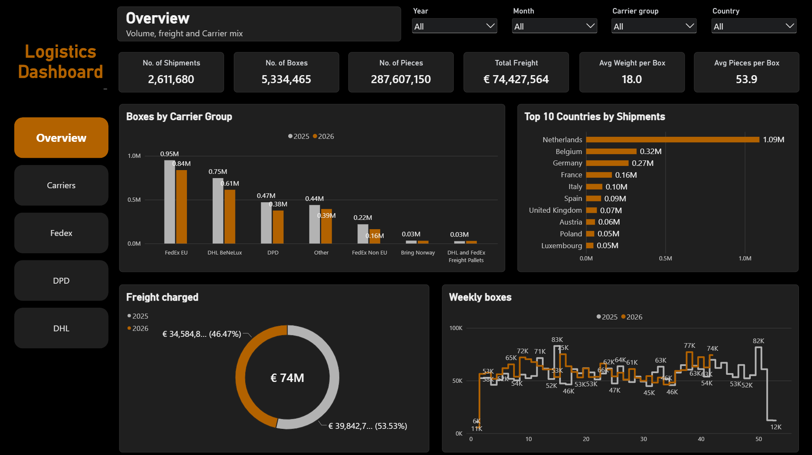
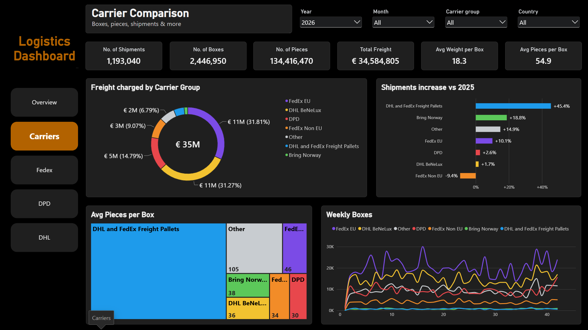
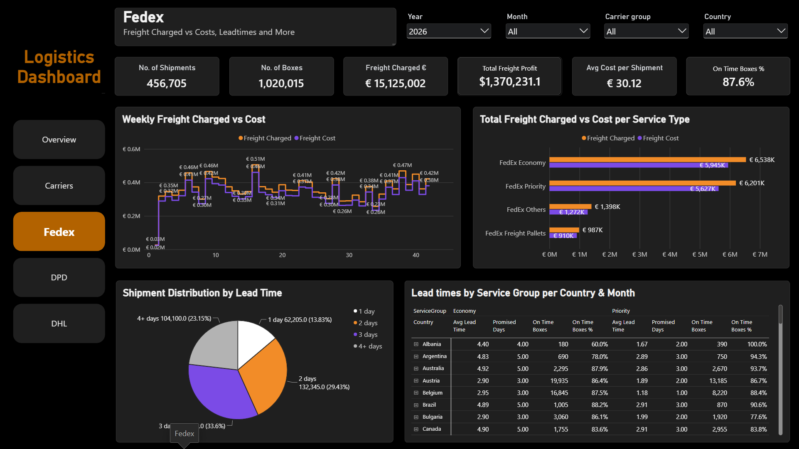
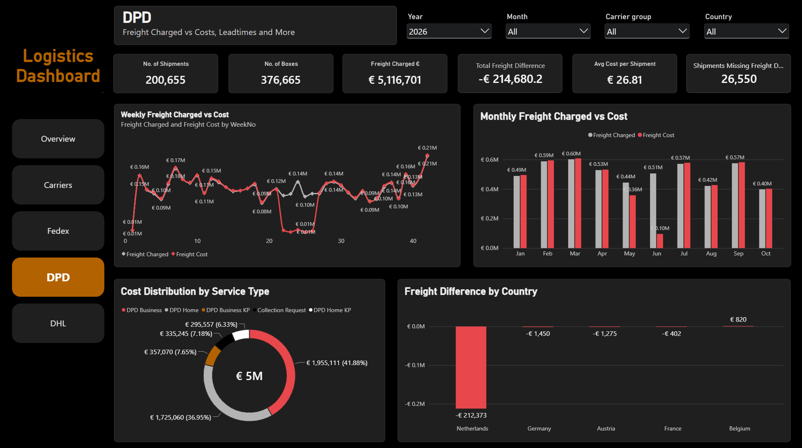
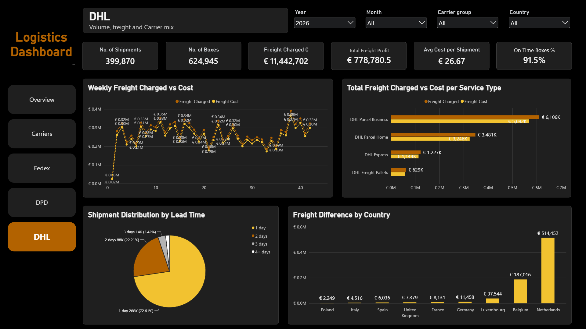

# Logistics Dashboard: Carrier Volume, Freight Margin and Delivery Performance

A five page Power BI report that shows a European parcel and freight operation how much it ships, where to, what each carrier costs against what is charged, and how reliably each carrier delivers.

## Design philosophy

A dashboard does not have to be the fanciest report in the company to be the most useful one. I keep the design simple and clean: one navigation bar, the same four filters on every page, KPI cards on top and four visuals below. What matters is what the page holds: the numbers and findings management cares about, laid out so a manager can spot a problem, see where it sits and decide what to do next.

## Problem and audience

The operation ships with several carriers, to many countries, on several service levels. Management needs one view of where the volume goes, whether freight cost stays below freight charged, and whether shipments arrive within the promised days. Built for operations and logistics management and for carrier rate reviews.

## Key findings

2026 figures run from January to week 42.

- **Spend is concentrated.** FedEx EU (€11M) and DHL BeNeLux (€11M) carry 63% of 2026 freight charged.
- **One market dominates.** The Netherlands has 1.09M shipments over both years, more than three times Belgium (0.32M).
- **Growth is uneven.** Freight pallets +45.4% vs 2025, Bring Norway +18.8%; FedEx Non EU is the only decline (-9.4%).
- **FedEx and DHL earn a margin.** FedEx €1,370,231 profit on €15,125,002 charged, DHL €778,781 on €11,442,702. About 90% of DHL profit comes from the Netherlands and Belgium.
- **DHL is faster.** 72.61% of DHL shipments arrive in 1 day, 91.5% of boxes on time. FedEx: 23.15% take 4+ days, 87.6% on time (FedEx also serves non EU destinations).
- **DPD cost data has a gap.** Weeks 22 to 26 show about €0.01M cost per week against €0.10M to €0.14M charged, and 26,550 shipments lack freight data. This points to a data completeness issue to check before reading DPD margin.

## The five pages

Navigate with the buttons on the left; filter every page by Year, Month, Carrier group and Country. Each screenshot sits above what the page answers, what it shows, and the decision it supports.

### Page 1: Overview

Filters: all years, all months, all carriers, all countries.

| | |
|---|---|
| **Answers** | How much do we ship, where to, with which carriers, and how does 2026 compare with 2025? |
| **KPI cards** | Shipments 2,611,680; Boxes 5,334,465; Pieces 287,607,150; Total Freight €74,427,564; Avg Weight per Box 18.0; Avg Pieces per Box 53.9. |
| **Boxes by carrier group** | 2025 vs 2026: FedEx EU 0.95M / 0.84M, DHL BeNeLux 0.75M / 0.61M, DPD 0.47M / 0.38M, Other 0.44M / 0.39M, FedEx Non EU 0.22M / 0.16M, Bring Norway and Freight Pallets about 0.03M each. 2026 is a partial year. |
| **Top 10 countries** | Netherlands 1.09M, Belgium 0.32M, Germany 0.27M, France 0.16M, Italy 0.10M, Spain 0.09M, UK 0.07M, Austria 0.06M, Poland 0.05M, Luxembourg 0.05M shipments. |
| **Freight charged** | €74M total: 2025 €39.8M (53.53%), 2026 €34.6M (46.47%). |
| **Weekly boxes** | Mostly 45K to 75K boxes a week in both years; 2026 runs to week 42. |
| **Insight** | Volume is steady week to week and concentrated in one country and two carrier groups. |
| **Decision** | Where to focus carrier reviews and capacity planning. |

### Page 2: Carrier Comparison

Filters: 2026.

| | |
|---|---|
| **Answers** | Which carriers take the freight spend, which are growing, and how do they differ? |
| **KPI cards** | Shipments 1,193,040; Boxes 2,446,950; Pieces 134,416,470; Total Freight €34,584,805; Avg Weight per Box 18.3; Avg Pieces per Box 54.9. |
| **Freight by carrier** | €35M total: FedEx EU €11M (31.81%), DHL BeNeLux €11M (31.27%), DPD €5M (14.79%), FedEx Non EU €3M (9.07%), Other €2M (6.79%); Freight Pallets and Bring Norway share the rest. |
| **Shipments vs 2025** | Freight Pallets +45.4%, Bring Norway +18.8%, Other +14.9%, FedEx EU +10.1%, DPD +2.6%, DHL BeNeLux +1.7%, FedEx Non EU -9.4%. |
| **Pieces per box** | Freight Pallets 486, Other 105, FedEx EU 46, Bring Norway 38, DHL BeNeLux 36, FedEx Non EU 34, DPD 30. |
| **Weekly boxes** | FedEx EU leads at about 15K to 30K a week, DHL BeNeLux second; DPD rises to about 15K in the last week shown. |
| **Insight** | Two carriers carry most of the spend; the fastest growth comes from a small base. |
| **Decision** | Which contracts matter most in a rate review, and whether pallet growth needs its own capacity or rates. |

### Page 3: FedEx

Filters: 2026.

| | |
|---|---|
| **Answers** | Is FedEx freight profitable by service, and does FedEx deliver on time per country? |
| **KPI cards** | Shipments 456,705; Boxes 1,020,015; Freight Charged €15,125,002; Total Freight Profit 1,370,231.1; Avg Cost per Shipment €30.12; On Time Boxes 87.6%. |
| **Weekly charged vs cost** | Charged mostly €0.26M to €0.47M a week, peak €0.51M; cost just below charged almost every week. |
| **By service type** | Charged vs cost: Economy €6,538K / €5,945K, Priority €6,201K / €5,627K, Others €1,398K / €1,272K, Freight Pallets €987K / €910K. |
| **Lead time mix** | 1 day 13.83%, 2 days 29.43%, 3 days 33.6%, 4+ days 23.15%. |
| **Lead time matrix** | Per country and month, for Economy and Priority: avg lead time, promised days, on time boxes and %. Example: Albania Economy 4.40 days vs 4.00 promised, 60.0% on time. |
| **Insight** | Margin is positive in every service; delivery speed is the open question. |
| **Decision** | Which country and service lanes to raise with FedEx, starting where lead time exceeds the promise. |

### Page 4: DPD

Filters: 2026.

| | |
|---|---|
| **Answers** | Does DPD freight cost match what is charged, and where is the difference? |
| **KPI cards** | Shipments 200,655; Boxes 376,665; Freight Charged €5,116,701; Total Freight Difference -€214,680.2; Avg Cost per Shipment €26.81; Shipments Missing Freight Data 26,550. |
| **Weekly charged vs cost** | Lines overlap in almost every week; in weeks 22 to 26 cost drops to about €0.01M while charged stays €0.10M to €0.14M. |
| **Monthly charged vs cost** | Cost level with or slightly above charged in eight months; May €0.36M cost vs €0.44M charged, June €0.10M vs €0.51M. |
| **Cost by service type** | €5M: DPD Business €1,955,111, DPD Home €1,725,060, DPD Business KP €357,070, Collection Request €335,245, DPD Home KP €295,557. |
| **Difference by country** | Netherlands -€212,373, Germany -€1,450, Austria -€1,275, France -€402, Belgium €820. |
| **Data check** | Cost by service type (€4,668,043) is below charged (€5,116,701), yet the difference card is negative, so the cards do not reconcile. €4,668,043 / 174,105 shipments with freight data = €26.81, the card value. |
| **Insight** | The cost gap, next to shipments missing freight data, points to a data completeness issue; the cause is not visible. |
| **Decision** | Hold DPD margin conclusions until the cost records for weeks 22 to 26 are checked. |

### Page 5: DHL

Filters: 2026.

| | |
|---|---|
| **Answers** | Is DHL freight profitable by service and country, and how fast does DHL deliver? |
| **KPI cards** | Shipments 399,870; Boxes 624,945; Freight Charged €11,442,702; Total Freight Profit €778,780.5; Avg Cost per Shipment €26.67; On Time Boxes 91.5%. |
| **Weekly charged vs cost** | Mostly €0.18M to €0.35M a week, high €0.39M; cost just below charged throughout. |
| **By service type** | Charged vs cost: Parcel Business €6,106K / €5,692K, Parcel Home €3,481K / €3,246K, Express €1,227K / €1,144K, Freight Pallets €629K charged. |
| **Lead time mix** | 1 day 72.61%, 2 days 22.21%, 3 days 3.42%, 4+ days the small remainder. |
| **Profit by country** | Netherlands €514,452, Belgium €187,016, Luxembourg €37,544, Germany €11,458, France €8,131, UK €7,379, Spain €6,036, Italy €4,516, Poland €2,249. These add up to the profit card. |
| **Insight** | DHL is fast and its profit is concentrated in the Netherlands and Belgium. |
| **Decision** | Start any shift of volume between carriers from the country split, not the total. |

## Tools and skills shown

- **Power BI:** five report pages, button navigation, consistent slicers, cards, charts and a drill down matrix.
- **DAX measures:** totals, per box and per shipment averages, freight profit and difference, on time percentage, comparison with the previous year.
- **Report design:** dark theme, one accent colour, a fixed colour per carrier, the same layout on every page.

## Data note

The figures in this report are illustrative. The underlying shipment data was scaled up 15 times, so volumes and amounts do not match any real operation; ratios, averages and patterns are unchanged. The employer is not named and no raw data or .pbix file is shared. The semantic model was built by the company's Power BI developer; I designed the report pages and wrote the DAX measures.

## About the author

Adrian Vanderlinder. I design Power BI reports around the questions management needs answered.

LinkedIn: [linkedin.com/in/adrian-van-der-linder-59b1299b](https://linkedin.com/in/adrian-van-der-linder-59b1299b)
